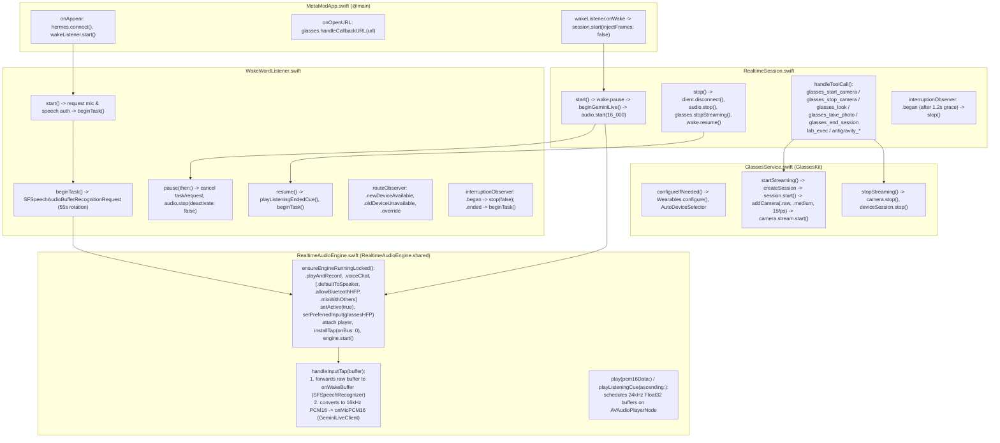

# Super Meta — Documentation Research, Codebase Map, and Failure Root-Cause Analysis

**Repository**: `~/Developer/super-meta` (`com.justinborgwardt.supermeta`)
**Baseline Commit**: `01c721a` (tag `toolkit-1.0.1-good`, parent `22d5277` tag `restore-good`)
**Saved Failure Branch**: `broken-attempt` (commit `6c06392`, plus earlier tags `step-2a-good` `9ced12a` and `gem-voice-good` `48f1a0d`)
**Meta Wearables Developer Center Project**: `2714718222311262`

---

## Part 1 (Phase 1): Documentation Research

### 1.1 Meta Wearables Device Access Toolkit (DAT) 1.0.1 Documentation

All 198 pages listed in [`https://wearables.developer.meta.com/llms.txt?product=all&version=1.0`](https://wearables.developer.meta.com/llms.txt?product=all&version=1.0) were fetched and read in full. Below are the exact rules, verbatim quotes, and URLs for every subsystem used by the app.

#### A. Getting Started, Architecture Overview, and iOS Build Integration
- **Sources**:
  - [Get started with the Toolkit](https://wearables.developer.meta.com/docs/getting-started-toolkit/)
  - [Architecture & Build Overview](https://wearables.developer.meta.com/docs/build-overview/)
  - [Initial setup for iOS](https://wearables.developer.meta.com/docs/build-integration-ios/)
  - [Version dependencies](https://wearables.developer.meta.com/docs/version-dependencies/)
- **Key Rules & Exact Quotes**:
  1. **Single Active Session Rule** ([Architecture & Build Overview](https://wearables.developer.meta.com/docs/build-overview/)):
     > *"Sessions represent your app's runtime connection to a specific wearable device. A session manages the lifecycle of capabilities (such as camera, speech, or display) that your app uses on the device. Only one session can run on a device at a time, and certain features are unavailable while your session is active."*
  2. **Required `Info.plist` Keys for iOS** ([Initial setup for iOS](https://wearables.developer.meta.com/docs/build-integration-ios/)):
     > *"Add the following keys to `Info.plist`:*
     > *- `UIBackgroundModes`: `bluetooth-central`, `external-accessory` (and `audio` if your app plays or records audio in the background).*
     > *- `UISupportedExternalAccessoryProtocols`: `com.meta.ar.wearable`*
     > *- `LSApplicationQueriesSchemes`: `fb-viewapp`*
     > *- `MWDAT`: dictionary containing `AppLinkURLScheme`, `MetaAppID`, and `ClientToken` (plus `TeamID` on iOS)."*
  3. **SDK Initialization & URL Callback Handling** ([Initial setup for iOS](https://wearables.developer.meta.com/docs/build-integration-ios/)):
     > *"Call `try Wearables.configure()` once at app launch before accessing `Wearables.shared`."*
     > *"Forward incoming deep links to the SDK with `try await Wearables.shared.handleUrl(url)` inside your SwiftUI `.onOpenURL` handler."*
  4. **Version Dependencies for DAT 1.0.x** ([Version dependencies](https://wearables.developer.meta.com/docs/version-dependencies/)):
     > *"SDK version 1.0 requires Meta AI app v264+ and glasses firmware v23+."*

#### B. Voice Invocations (`"Hey Meta, start Gem"`)
- **Sources**:
  - [Use voice invocations (Guide)](https://wearables.developer.meta.com/docs/develop/dat/voice-invocations/)
  - [VoiceInvocationsStream (iOS Reference)](https://wearables.developer.meta.com/docs/reference/ios_swift/dat/1.0/MWDATCore_VoiceInvocationsStream/)
  - [VoiceInvocation (iOS Reference)](https://wearables.developer.meta.com/docs/reference/ios_swift/dat/1.0/MWDATCore_VoiceInvocation/)
  - [LaunchApp (iOS Reference)](https://wearables.developer.meta.com/docs/reference/ios_swift/dat/1.0/MWDATCore_LaunchApp/)
  - [ResponseHandle (iOS Reference)](https://wearables.developer.meta.com/docs/reference/ios_swift/dat/1.0/MWDATCore_ResponseHandle/)
  - [VoiceInvocationError (iOS Reference)](https://wearables.developer.meta.com/docs/reference/ios_swift/dat/1.0/MWDATCore_VoiceInvocationError/)
- **Key Rules & Exact Quotes**:
  1. **How Invocation Phrases Work** ([Use voice invocations](https://wearables.developer.meta.com/docs/develop/dat/voice-invocations/)):
     > *"When the wearer says 'Hey Meta, start {YOUR APP NAME}', Meta AI launches or foregrounds your app and sends it a voice invocation. Your app receives the invocation, does the work, and acknowledges it back to the glasses. If your app is not already running, the command cold-launches it."*
     > *"Meta AI uses the app name from your Wearables Developer Center project to generate the invocation phrases, for example: 'Hey Meta, open {YOUR APP NAME}' or 'Hey Meta, start {YOUR APP NAME}'."*
  2. **Configured Entirely in Developer Center + Requires a New Integration Version** ([Use voice invocations](https://wearables.developer.meta.com/docs/develop/dat/voice-invocations/)):
     > *"Invocation phrases are not declared in your Android manifest or `Info.plist`, and voice invocations do not require a `CAMERA` or `MICROPHONE` permission request. Whether invocations reach your app is determined entirely by your Developer Center configuration."*
     > *"After saving your configuration, create a new version of the integration. The new version includes the Voice Invocation permission."*
     > *"Wait until the version's status is `Ready`, then publish it to your release channel."*
  3. **Wearables-Level Stream (No `DeviceSession` Required)** ([Use voice invocations](https://wearables.developer.meta.com/docs/develop/dat/voice-invocations/)):
     > *"Voice invocations are not a device-session capability. They are a `Wearables`-level stream: you do not add a capability to a session, and you do not need a running device session."*
  4. **Mandatory Listener Ordering & Immediate Acknowledgement** ([Use voice invocations](https://wearables.developer.meta.com/docs/develop/dat/voice-invocations/) & [`VoiceInvocationsStream`](https://wearables.developer.meta.com/docs/reference/ios_swift/dat/1.0/MWDATCore_VoiceInvocationsStream/)):
     > *"Register listeners on `invocationsPublisher` and `errorPublisher` before calling `start(deviceIdentifier:)` so you don't miss an invocation queued during a cold launch."*
     > *"Answer every invocation exactly once. Failing to answer leaves Meta AI waiting on the request and may surface a fallback UI to the wearer."*
     > *"Call `await launch.responseHandle.sendSuccess(actionOutput: nil)` (or `sendFailure()`) as soon as your app receives `LaunchApp`."*

#### C. On-Glasses Speech Recognition (`MWDATSpeech`)
- **Sources**:
  - [Use speech recognition (Guide)](https://wearables.developer.meta.com/docs/develop/dat/speech/)
  - [Known issues](https://wearables.developer.meta.com/docs/knownissues/)
  - [Speech (iOS Reference)](https://wearables.developer.meta.com/docs/reference/ios_swift/dat/1.0/MWDATSpeech_Speech/)
  - [SpeechState (iOS Reference)](https://wearables.developer.meta.com/docs/reference/ios_swift/dat/1.0/MWDATSpeech_SpeechState/)
  - [SpeechError (iOS Reference)](https://wearables.developer.meta.com/docs/reference/ios_swift/dat/1.0/MWDATSpeech_SpeechError/)
  - [TranscriptionResult (iOS Reference)](https://wearables.developer.meta.com/docs/reference/ios_swift/dat/1.0/MWDATSpeech_TranscriptionResult/)
- **Key Rules & Exact Quotes**:
  1. **Requires an Active `DeviceSession` in `.started` State + `.microphone` Permission** ([Use speech recognition](https://wearables.developer.meta.com/docs/develop/dat/speech/)):
     > *"The Speech capability is attached to a session (`DeviceSession` in the `STARTED` state) and requires the `MICROPHONE` permission from the Meta AI app."*
     > *"Call `try session.addSpeech()` after the session reaches `started`, subscribe to `transcriptionPublisher`, `statePublisher`, and `errorPublisher`, and then call `speech.start()`."*
  2. **Designed for Short Active Feature Use, Not 24/7 Idle Standby** ([Use speech recognition](https://wearables.developer.meta.com/docs/develop/dat/speech/)):
     > *"Run Speech only while your feature needs transcriptions to limit battery use. Observe `SpeechState` because the capability can stop after inactivity, a timeout, or another performance constraint."*
  3. **60-Second Silent Cutoff Bug in DAT 1.0** ([Known issues](https://wearables.developer.meta.com/docs/knownissues/)):
     > *"Dev and Beta: Beyond one minute following the start time, the speech capability silently stops reporting text to the app, yielding no error or notification. Workaround: Add code to handle restarting the speech capability."*

#### D. Microphones, Speakers, Bluetooth HFP vs. A2DP, and Audio Streaming
- **Sources**:
  - [Use microphones and speakers](https://wearables.developer.meta.com/docs/develop/dat/microphones-and-speakers/)
  - [Stream from the glasses camera (and audio)](https://wearables.developer.meta.com/docs/develop/dat/streaming/)
  - [StreamConfiguration (iOS Reference)](https://wearables.developer.meta.com/docs/reference/ios_swift/dat/1.0/MWDATCamera_StreamConfiguration/)
  - [AudioCodec (iOS Reference)](https://wearables.developer.meta.com/docs/reference/ios_swift/dat/1.0/MWDATCamera_AudioCodec/)
  - [AudioFrame (iOS Reference)](https://wearables.developer.meta.com/docs/reference/ios_swift/dat/1.0/MWDATCamera_AudioFrame/)
- **Key Rules & Exact Quotes**:
  1. **Two Ways Audio Reaches the Phone from the Glasses**:
     - **Path 1 — Standard Bluetooth Audio Profiles (`AVAudioSession`)** ([Use microphones and speakers](https://wearables.developer.meta.com/docs/develop/dat/microphones-and-speakers/)):
       > *"Meta AI glasses connect to the phone as a standard Bluetooth audio device supporting two profiles:*
       > *- **A2DP (Advanced Audio Distribution Profile)**: High-quality stereo audio output (44.1 kHz or 48 kHz), output-only (no microphone).*
       > *- **HFP (Hands-Free Profile)**: Bidirectional mono voice audio (8 kHz or 16 kHz) using the glasses' beamformed microphone array."*
       > *"The two profiles are mutually exclusive: activating HFP switches the glasses away from A2DP, and audio output drops to mono voice quality (16 kHz or 8 kHz) for the duration of the session."*
     - **Path 2 — DAT Camera Stream Audio (`MWDATCamera.Stream.audioFramePublisher`)** ([Stream from the glasses camera](https://wearables.developer.meta.com/docs/develop/dat/streaming/) & [`StreamConfiguration`](https://wearables.developer.meta.com/docs/reference/ios_swift/dat/1.0/MWDATCamera_StreamConfiguration/)):
       > *"When `StreamConfiguration.audioCodec` is set to `.pcm(sampleRate: .rate16000, numberOfChannels: 1)` (or `.rate48000` / `2` channels), the camera stream delivers `AudioFrame` buffers on `camera.stream.audioFramePublisher` alongside video frames. Requires `Permission.microphone` granted in Meta AI."*
  2. **Mandatory Ordering When Using Bluetooth HFP Alongside a DAT Camera Stream** ([Use microphones and speakers](https://wearables.developer.meta.com/docs/develop/dat/microphones-and-speakers/)):
     > *"When your app uses both the HFP microphone and a Device Access Toolkit camera stream, start them in this order:*
     > *1. Configure and start the HFP microphone. Wait for the route to settle.*
     > *2. Start the Device Access Toolkit camera stream.*
     > *Starting the Device Access Toolkit stream before HFP is ready can cause the audio route to fail silently."*

#### E. Camera Streaming and Photo Capture (`MWDATCamera`)
- **Sources**:
  - [Stream from the glasses camera](https://wearables.developer.meta.com/docs/develop/dat/streaming/)
  - [Capture photos](https://wearables.developer.meta.com/docs/develop/dat/camera-capture/)
  - [Camera (iOS Reference)](https://wearables.developer.meta.com/docs/reference/ios_swift/dat/1.0/MWDATCamera_Camera/)
  - [Stream (iOS Reference)](https://wearables.developer.meta.com/docs/reference/ios_swift/dat/1.0/MWDATCamera_Stream/)
  - [Photo (iOS Reference)](https://wearables.developer.meta.com/docs/reference/ios_swift/dat/1.0/MWDATCamera_Photo/)
- **Key Rules & Exact Quotes**:
  1. **VideoCodec Background Behavior (`.raw` vs. `.hvc1`)** ([StreamConfiguration](https://wearables.developer.meta.com/docs/reference/ios_swift/dat/1.0/MWDATCamera_StreamConfiguration/) & `CHANGELOG.md`):
     > *"Raw video streams (`.raw`) are automatically paused when the app enters the background. Compressed HEVC streams (`.hvc1`) can continue streaming while the app is backgrounded."*
  2. **Stream vs. Photo Mutual Exclusion** ([Capture photos](https://wearables.developer.meta.com/docs/develop/dat/camera-capture/)):
     > *"Video streaming and still photo capture share the camera sensor. If `camera.stream` is actively streaming, stop the stream before calling `camera.photo.capturePhoto(...)`, or capture directly from the live video frames."*

#### F. Session Lifecycle, Device State, and Inputs (`MWDATCore`, `MWDATInputs`)
- **Sources**:
  - [Manage session lifecycle events](https://wearables.developer.meta.com/docs/develop/dat/lifecycle-events/)
  - [Monitor device state](https://wearables.developer.meta.com/docs/develop/dat/device-state/)
  - [Receive hardware input events](https://wearables.developer.meta.com/docs/develop/dat/inputs/)
- **Key Rules & Exact Quotes**:
  1. **`DeviceSessionState` Transitions** ([Manage session lifecycle events](https://wearables.developer.meta.com/docs/develop/dat/lifecycle-events/)):
     > *"A `DeviceSession` moves through `idle` -> `starting` -> `started` -> `paused` / `stopping` -> `stopped`. `stopped` is terminal; once a session reaches `stopped`, you must create a new `DeviceSession` to start again."*
  2. **Advisory Warning `.dwaOutOfStuRange`** ([DeviceSessionError](https://wearables.developer.meta.com/docs/reference/ios_swift/dat/1.0/MWDATCore_DeviceSessionError/)):
     > *"`dwaOutOfStuRange` indicates the device's STU/range state is degraded; it does not by itself terminate the session unless `statePublisher` transitions to `.stopped`."*

#### G. Permissions, Developer Center Projects, and Release Channels
- **Sources**:
  - [Request permissions](https://wearables.developer.meta.com/docs/develop/dat/permissions-requests/)
  - [Manage projects in the Wearables Developer Center](https://wearables.developer.meta.com/docs/manage-projects/)
  - [Set up release channels and distribute your app](https://wearables.developer.meta.com/docs/set-up-release-channels/)
  - [Known issues](https://wearables.developer.meta.com/docs/knownissues/)
- **Key Rules & Exact Quotes**:
  1. **When a New Integration Version Is Required** ([Set up release channels and distribute your app](https://wearables.developer.meta.com/docs/set-up-release-channels/)):
     > *"Each version details product specifics, including the name, icon, and any edits to permission requests or app configuration... When you change any of these details, you need to create a new version of the integration so you can distribute it to testers on a release channel."*
  2. **Waiting for `Ready` Status Before Using a Version** ([Set up release channels and distribute your app](https://wearables.developer.meta.com/docs/set-up-release-channels/)):
     > *"Device Access Toolkit automatically generates a corresponding application for each new version. Builds usually complete within 10 minutes, but may take up to 30 minutes. Use a version with a release channel only after its Device Access Toolkit app finishes building:*
     > *- **In Progress**: Device Access Toolkit application is building.*
     > *- **Ready**: Device Access Toolkit application is ready to distribute."*
  3. **Beta Channel Compatibility with DAT 1.0 SDK** ([Known issues](https://wearables.developer.meta.com/docs/knownissues/)):
     > *"Beta testing: If your application is using the latest SDK and has the Device Access Toolkit Wearables App enabled, it may not be compatible with old versions on WDC. Workaround: Create a new version on WDC and push to beta testers via a Release Channel."*

---

### 1.2 `facebook/meta-wearables-dat-ios` Repository (`v1.0.1`)

Cloned and read in full from [`https://github.com/facebook/meta-wearables-dat-ios`](https://github.com/facebook/meta-wearables-dat-ios) at tag `1.0.1`.

#### A. `CHANGELOG.md` and 0.x -> 1.0.1 Migration Notes
- **Breaking API Changes from 0.x to 1.0.0 / 1.0.1** (`CHANGELOG.md` & `plugins/mwdat-ios/skills/mwdat-ios-migrate/SKILL.md`):
  - `StreamSession`, `StreamSessionConfig`, and `StreamSessionState` were removed and replaced by `DeviceSession` (`Wearables.shared.createSession(deviceSelector:)`), `MWDATCamera.Camera` (`session.addCamera(config:)`), `MWDATCamera.Stream` (`camera.stream`), and `MWDATCamera.Photo` (`camera.photo`).
  - New capabilities added in 1.0.0:
    - `MWDATCore.VoiceInvocationsStream` (`LaunchApp` + `ResponseHandle`)
    - `MWDATSpeech.Speech` (`session.addSpeech()`)
    - `MWDATInputs.Inputs` (`session.addInputs(configuration:)`)
    - `MWDATMotion.Motion` (`session.addMotion(configuration:)`)
    - `MWDATDisplay.Display` (`session.addDisplay()`)
  - `Permission` gained `.microphone` (for on-glasses `MWDATSpeech` and `MWDATCamera.Stream` audio).
  - `CHANGELOG.md` v0.5.0 note on background video codecs:
    > *"Changed background behavior to pause raw video streams when the app enters the background while allowing compressed (HEVC) streams to continue."*

#### B. All 17 Official Skills under `plugins/mwdat-ios/skills/`
Every `SKILL.md` under `plugins/mwdat-ios/skills/` was read in full:
1. `mwdat-ios-Overview`: Maps capabilities to frameworks (`MWDATCore`, `MWDATCamera`, `MWDATSpeech`, `MWDATInputs`, `MWDATMotion`, `MWDATDisplay`, `MWDATMockDevice`).
2. `mwdat-ios-setup`: Covers `Info.plist`, `Wearables.configure()`, `handleUrl(url)`, registration, and `checkPermissionStatus` / `requestPermission`.
3. `mwdat-ios-device-discovery`: Covers `AutoDeviceSelector`, `SpecificDeviceSelector`, `devicesStream()`, `deviceForIdentifier(_:)`, `addLinkStateListener`, `addDeviceStateListener`, and `addCompatibilityListener`.
4. `mwdat-ios-device-session`: Covers `createSession`, `statePublisher`, `errorPublisher`, `start()`, `stop()`, and waiting for `.started` before attaching capabilities.
5. `mwdat-ios-camera-streaming`: Covers `StreamConfiguration`, `addCamera`, `camera.stream.videoFramePublisher`, `audioFramePublisher`, `statePublisher`, `errorPublisher`.
6. `mwdat-ios-photo-capture`: Covers `camera.photo.photoDataPublisher`, `capturePhoto(resolution:quality:)`, and stopping video stream before photo capture.
7. `mwdat-ios-audio`: Covers Bluetooth HFP vs. A2DP routing (`AVAudioSession.Category.playAndRecord`, `.allowBluetoothHFP`, HFP-before-camera-stream rule) and `camera.stream.audioFramePublisher`.
8. `mwdat-ios-speech`: Covers `session.addSpeech()`, `Permission.microphone`, `transcriptionPublisher`, `statePublisher`, `errorPublisher`, `speech.start()`, `speech.stop()`.
9. `mwdat-ios-voice-invocations`: Covers `VoiceInvocationsStream(wearables:)`, registering listeners before `start(deviceIdentifier:)`, handling `LaunchApp`, and calling `launch.responseHandle.sendSuccess(actionOutput: nil)`.
10. `mwdat-ios-inputs`: Covers `InputsConfiguration(sources:consumeBack:)`, `session.addInputs`, and single-consumer `inputs.events`.
11. `mwdat-ios-motion`: Covers `MotionConfiguration(samplingRate:)`, `session.addMotion`, `motion.samples`, `motion.start()`.
12. `mwdat-ios-display`: Covers `device.supportsDisplay()`, `session.addDisplay()`, `DisplayableView`, `sendView(_:)`.
13. `mwdat-ios-mock-device`: Covers `MockDeviceKit.shared.pairRaybanMeta()`, mock camera/speech/voice invocation simulation.
14. `mwdat-ios-migrate`: Covers migrating 0.x `StreamSession` code to 1.0 `DeviceSession` + `Camera`.
15. `mwdat-ios-doctor`, `mwdat-ios-review`, `mwdat-ios-troubleshoot`: Diagnostic checklists for `Info.plist`, Developer Center version readiness, permissions, and session lifecycle.

#### C. Full Source Analysis of `samples/BirdSpotter`
Every Swift file in `samples/BirdSpotter` was inspected. Key architectural facts and verbatim quotes from Meta's reference implementation:

1. **`DatGlassesVoiceRepository.swift` (How `"Hey Meta, start <App>"` is implemented)**:
   - Lines 19–40:
     > *"Meta AI holds every invocation open until the app replies through its response handle, and announces the app as not responding when no reply comes — opening on screen is not the answer, the reply is. So each invocation is answered here, the moment it arrives: success for a launch, before anything upstream reacts to it... A launch is what asks for a session, so the channel cannot ride one — it listens on a device of its own choosing instead... Meta AI routes an invocation only to a registered app and holds the launch open until the app answers, so the open is held back until registration lands... A channel that then drops is reopened rather than logged and left down: the drop arrives on the error publisher, not by ending a stream, so a first drop that went unhandled would be permanent and the held launch lost for the life of the process."*
   - Lines 175–224: Subscribes `invocationsPublisher.listen` and `errorPublisher.listen` **before** calling `stream.start(deviceIdentifier: preferred)`. Watches `Wearables.shared.devicesStream()` and attaches `device.addLinkStateListener` (NOT `addDeviceStateListener`!) on each device to call `ensureListening()`, which only calls `stream.start(deviceIdentifier: preferred)` when `preferred != listeningOn`.
2. **`ContentView.swift` (Starting a Session When Locked in a Pocket)**:
   - Lines 90–102:
     > *"**Two effects, deliberately.** The session is started here, directly, because the launch may land with the phone locked in a pocket — no cover can rise and nothing on screen will run — and the wearer still asked for a session. Raising the cover is the second effect, for when there is a screen to raise it on."*
3. **`FailoverAudioSource.swift`, `MicrophoneCapture.swift`, `GlassesMicrophoneSource.swift`, `SystemSpokenOutput.swift`, and `DatGlassesSessionRepository.swift` (Locked-Phone Audio & Glasses Microphone Architecture)**:
   - **`FailoverAudioSource.swift` lines 41–48**:
     > *"**A phone that will not open is waited for, not given up on.** The session's spine is this stream, and a stream that fails ends the session — which is the wrong answer for the two ways the phone's microphone ordinarily refuses: a session started with the phone locked in a pocket (the platform will not open a recorder from there until the first unlock) and a phone call taking the microphone mid-walk. Both come back on their own, so the stream stays open, empty, and tries the phone again every `fallbackRetryDelay` — and the glasses, once asked for, open the moment they are asked, because their microphone is not a recorder at all. The one refusal that is final is the grant being gone."*
   - **`GlassesMicrophoneSource.swift` lines 16–27**:
     > *"**It rides the camera stream.** DAT carries the glasses' microphone as audio on the same stream that wakes the camera, so there is no audio route to select and no audio session to share: the samples arrive from the SDK already the glasses', at the 16 kHz mono the stream was asked for, and `DatGlassesSessionRepository` turns them into `AudioChunk`s. This class is the lease on that feed and nothing more. The consequence the platform's own audio stack used to hide is that **the phone and the glasses are now two independent microphones.** Opening one no longer closes the other, and a line spoken while the glasses listen goes out over the media profile at full bandwidth."*
   - **`DatGlassesSessionRepository.swift` lines 662–672**:
     > *"**Compressed, not raw, and the reason is the pocket.** The SDK pauses a raw stream the moment the app leaves the foreground and keeps an HEVC one flowing (its changelog says so, at 0.5.0). This stream is the glasses' microphone, so a raw stream would be a session that goes deaf when the phone is locked. Nothing here ever decodes a frame, so the codec costs the app nothing either way."*
     > ```swift
     > let config = StreamConfiguration(
     >   videoCodec: .hvc1,
     >   audioCodec: carriesAudio ? .pcm(sampleRate: .rate16000, numberOfChannels: 1) : nil,
     >   resolution: .low,
     >   frameRate: 7
     > )
     > ```
   - **`DatGlassesSessionRepository.swift` lines 396–406 & 750–760** (Why `addSpeech()` alone fails without `camera.stream`):
     > *"`started` means the session exists, not that the glasses are reachable. The device is still arriving at this point — the camera says so out loud, spending its first beats in `waitingForDevice` — and a capability started into that window fails with `deviceDisconnected` and does not try again. So only the camera is attached here, because only the camera is willing to wait. The sensors follow it, once its frames have proved the device is really there."*

#### D. Full Source Analysis of `samples/CameraAccess`
Every Swift file in `samples/CameraAccess` was inspected. Key findings from `CameraAccess/Audio/AudioInputHandler.swift`:
- **Lines 179–193**: Configures `AVAudioSession` with `.playAndRecord`, mode `.default`, options `[.allowBluetoothHFP, .defaultToSpeaker]`, `setActive(true)`, and selects `.bluetoothHFP` input via `setPreferredInput(glassesInput)`.
- **Lines 212–233 (Avoiding the `.override` Route Change Infinite Loop)**:
  > ```swift
  > switch reason {
  > case .newDeviceAvailable, .oldDeviceUnavailable:
  >   // A Bluetooth device connected or disconnected — reset the engine so
  >   // the input node picks up the new hardware sample rate, then re-route.
  >   // These reasons come from hardware, not our own config calls, so there's
  >   // no reconfigure loop.
  >   resetAudioEngine()
  > default:
  >   break
  > }
  > ```
  Calling `session.setPreferredInput(...)` triggers `AVAudioSession.routeChangeNotification` with `reason == .override`. If a route observer reacts to `.override` by resetting the engine and calling `setPreferredInput(...)` again, it creates an infinite reconfiguration loop!

---

### 1.3 Apple Documentation (`AVAudioSession`, `AVAudioEngine`, Background Audio, Privacy Indicator, `SFSpeechRecognizer`, Bluetooth Routing)

Fetched and read 81 official Apple DocC pages plus Apple's iPhone User Guide for the hardware privacy indicator.

#### A. iOS Orange Microphone Privacy Indicator
- **Source**: [Apple Support — Control access to hardware features on iPhone](https://support.apple.com/guide/iphone/control-access-to-hardware-features-iph168c4bbd5/ios)
- **Exact Quote**:
  > *"An orange indicator appears whenever an app uses the microphone without the camera. A green indicator appears whenever an app uses the camera (or the camera and the microphone)."*
- **Technical Rule**:
  - The orange microphone indicator is enforced by iOS system daemons (`mediaserverd` / `sensor-indicators`) whenever any audio input (`AVAudioEngine.inputNode`, `AVAudioRecorder`, `AudioUnit` input bus, or `SFSpeechAudioBufferRecognitionRequest` fed by an input tap) is active on an `AVAudioSession` with an input-capable category (`.record` or `.playAndRecord`).
  - Routing input to a Bluetooth HFP headset/glasses mic (`.bluetoothHFP`) **still** lights the iPhone orange microphone indicator.
  - The **only** states in which the iPhone orange microphone indicator is OFF are:
    1. `AVAudioSession` is deactivated (`setActive(false, options: .notifyOthersOnDeactivation)`), OR
    2. `AVAudioSession` is in an output-only category (`.playback`, `.ambient`, `.soloAmbient`) with no input node/recorder active, OR
    3. The app is receiving audio bytes over an ExternalAccessory data channel (`MWDATCamera.Stream.audioFramePublisher`) rather than through iOS's `AVAudioSession` audio input (though `MWDATCamera.Stream` lights the glasses' camera LED instead).

#### B. `AVAudioSession` Categories, Modes, Options, Activation, and Errors
- **Sources**:
  - [`AVAudioSession`](https://developer.apple.com/documentation/avfaudio/avaudiosession)
  - [`AVAudioSession.Category.playAndRecord`](https://developer.apple.com/documentation/avfaudio/avaudiosession/category-swift.struct/playandrecord)
  - [`AVAudioSession.Category.playback`](https://developer.apple.com/documentation/avfaudio/avaudiosession/category-swift.struct/playback)
  - [`AVAudioSession.CategoryOptions.allowBluetoothHFP`](https://developer.apple.com/documentation/avfaudio/avaudiosession/categoryoptions/allowbluetoothhfp)
  - [`AVAudioSession.CategoryOptions.allowBluetoothA2DP`](https://developer.apple.com/documentation/avfaudio/avaudiosession/categoryoptions/allowbluetootha2dp)
  - [`AVAudioSession.CategoryOptions.mixWithOthers`](https://developer.apple.com/documentation/avfaudio/avaudiosession/categoryoptions/mixwithothers)
  - [`AVAudioSession.setActive(_:options:)`](https://developer.apple.com/documentation/avfaudio/avaudiosession/setactive(_:options:))
  - [`AVAudioSession.ErrorCode`](https://developer.apple.com/documentation/coreaudiotypes/avaudiosession/errorcode)
  - [`AVAudioSession.ErrorCode.cannotStartRecording`](https://developer.apple.com/documentation/coreaudiotypes/avaudiosession/errorcode/cannotstartrecording)
  - [`AVAudioSession.ErrorCode.cannotInterruptOthers`](https://developer.apple.com/documentation/coreaudiotypes/avaudiosession/errorcode/cannotinterruptothers)
- **Key Rules & Exact Quotes**:
  1. **`allowBluetoothHFP` vs. `allowBluetoothA2DP` Priority** ([`allowBluetoothA2DP`](https://developer.apple.com/documentation/avfaudio/avaudiosession/categoryoptions/allowbluetootha2dp)):
     > *"If this option and the `allowBluetooth` (`allowBluetoothHFP`) option are both set, when a single device supports both the Hands-Free Profile (HFP) and A2DP, the system gives hands-free ports a higher priority for routing."*
     - **Critical Consequence on Meta Ray-Ban Glasses**: As soon as an active `.playAndRecord` session includes `.allowBluetoothHFP`, iOS routes the session to the glasses' HFP port and opens the Bluetooth HFP SCO voice link. The glasses firmware treats an active HFP SCO link as **an active phone call**.
  2. **Deactivating and Returning the Mic to iOS and Other Apps** ([`setActive(_:options:)`](https://developer.apple.com/documentation/avfaudio/avaudiosession/setactive(_:options:)) & [`notifyOthersOnDeactivation`](https://developer.apple.com/documentation/avfaudio/avaudiosession/setactiveoptions/notifyothersondeactivation)):
     > *"Deactivating your session fails if any associated audio objects (such as `AVAudioPlayer`, `AVAudioRecorder`, `AVAudioEngine`, or `AUGraph`) are still running. Stop all audio objects before calling `setActive(false, options: .notifyOthersOnDeactivation)`."*
     > *"An option that indicates that the system should notify other apps that you've deactivated your app's audio session."*
  3. **Starting Audio Recording from Background / Locked Screen** ([`cannotStartRecording`](https://developer.apple.com/documentation/coreaudiotypes/avaudiosession/errorcode/cannotstartrecording) & [`cannotInterruptOthers`](https://developer.apple.com/documentation/coreaudiotypes/avaudiosession/errorcode/cannotinterruptothers)):
     > *"`cannotStartRecording` (`561145187` / `!rec`): An error code that indicates an attempt to start audio recording, but the operation failed. Discussion: This error type usually occurs when an app starts a mixable recording from the background and it isn't configured as an Inter-App Audio app."*
     > *"`cannotInterruptOthers` (`560557684` / `!int`): An error code that indicates an attempt to make a nonmixable audio session active while the app was in the background."*

#### C. `SFSpeechRecognizer` & `SFSpeechAudioBufferRecognitionRequest`
- **Sources**:
  - [`SFSpeechRecognizer`](https://developer.apple.com/documentation/speech/sfspeechrecognizer)
  - [`SFSpeechAudioBufferRecognitionRequest`](https://developer.apple.com/documentation/speech/sfspeechaudiobufferrecognitionrequest)
- **Key Rules & Exact Quotes**:
  > *"Speech recognition is intended for short-duration tasks. Individual recognition requests are limited to approximately one minute of audio."*
  > *"Set `requiresOnDeviceRecognition = true` to perform recognition locally on the device without network dependency."*

---

### 1.4 Reference Codebases (`~/src/VisionClaw` and `~/Developer/OpenGlasses`)

Both local repositories were read in full.

#### A. `~/src/VisionClaw`
- **Files Analyzed**:
  - `samples/CameraAccess/CameraAccess/Gemini/GeminiSessionViewModel.swift`
  - `samples/CameraAccess/CameraAccess/Gemini/GeminiLiveService.swift`
  - `samples/CameraAccess/CameraAccess/ViewModels/StreamSessionViewModel.swift`
  - `samples/CameraAccess/CameraAccess/Gemini/AudioManager.swift`
- **How It Works & Key Takeaways**:
  1. **No Wake Word Listener**: VisionClaw has no background wake word listener and no `VoiceInvocationsStream`; sessions are started manually from the UI (`GeminiBarView`).
  2. **HFP-First Ordering (`GeminiSessionViewModel.swift:84-99`)**:
     ```swift
     try liveService.setupAudioSession()
     // Let Bluetooth HFP route settle before starting AudioEngine + mic tap
     try? await Task.sleep(nanoseconds: 500_000_000) // 500ms
     ```
     VisionClaw activates `.playAndRecord` with `[.defaultToSpeaker, .allowBluetoothHFP]` (`GeminiLiveService.swift:329-336`) ONLY when a Gemini Live session starts, waits 500 ms for the HFP route to settle before starting `AVAudioEngine`, and calls `AVAudioSession.sharedInstance().setActive(false, options: .notifyOthersOnDeactivation)` when the session stops (`GeminiLiveService.swift:387-390`).
  3. **Client-Side Barge-In Suppression During Tool Calls (`GeminiSessionViewModel.swift:128-140`)**: Suppresses `turnComplete` interrupts while `activeToolCalls > 0` so multi-step tool executions are not cut off.

#### B. `~/Developer/OpenGlasses`
- **Files Analyzed**:
  - `OpenGlasses/Sources/Core/AssistantOrchestrator.swift`
  - `OpenGlasses/Sources/WakeWord/VoiceWakeWordDetector.swift`
  - `OpenGlasses/Sources/Services/GeminiLiveSession.swift`
  - `OpenGlasses/Sources/Glasses/MetaGlassesManager.swift`
  - `OpenGlasses/Sources/Services/SpeechTranscriber.swift`
- **How It Works & Key Takeaways**:
  1. **Wake Word (`VoiceWakeWordDetector.swift`)**:
     - Uses `SFSpeechRecognizer` + `AVAudioEngine` with `.playAndRecord`, mode `.voiceChat`, options `[.defaultToSpeaker, .allowBluetoothHFP, .mixWithOthers]` (`VoiceWakeWordDetector.swift:318-323`).
     - Rotates the `SFSpeechAudioBufferRecognitionRequest` every 55 seconds (`VoiceWakeWordDetector.swift:271-278`) while keeping `AVAudioEngine` running.
     - **Limitations**: Because `VoiceWakeWordDetector` keeps `.playAndRecord` + `.allowBluetoothHFP` active continuously during standby, OpenGlasses **always shows the iPhone orange mic indicator** and **always holds the glasses in Bluetooth HFP call mode** (and does not use `VoiceInvocationsStream` or `MWDATSpeech`).
  2. **Stopping and Recreating `AVAudioEngine` Between Wake and Gemini Live (`AssistantOrchestrator.swift:262-267`, `GeminiLiveSession.swift:238-259`)**:
     - OpenGlasses stops `VoiceWakeWordDetector`'s `AVAudioEngine` and creates a second `AVAudioEngine` inside `GeminiLiveSession` (`setupAudio()`), calling `setCategory(.playAndRecord, mode: .voiceChat, options: [.defaultToSpeaker, .allowBluetoothHFP])` (dropping `.mixWithOthers`). On a locked iPhone, stopping one `AVAudioEngine` and activating a non-mixable session from the background fails with `OSStatus 560557684` (`AVAudioSession.ErrorCode.cannotInterruptOthers`), which is why `Super Meta`'s `restore-good` baseline unified wake-word and Gemini Live onto a single shared `RealtimeAudioEngine.shared`.
  3. **DAT 1.0 `.dwaOutOfStuRange` Advisory (`MetaGlassesManager.swift:165-171`)**:
     - OpenGlasses explicitly logs and ignores `DeviceSessionError.dwaOutOfStuRange` so transient STU range warnings do not tear down the active camera session.

---

### 1.5 What the Toolkit and iOS Allow, What They Don't, and What That Means for Each Goal

#### A. What the Toolkit (DAT 1.0.1) and iOS Allow
1. **Passive `"Hey Meta, start Gem"` Voice Invocations with Zero Idle Audio Session**:
   - `VoiceInvocationsStream` runs over the ExternalAccessory Bluetooth control channel (`com.meta.ar.wearable`, kept alive by `UIBackgroundModes: ["bluetooth-central", "external-accessory"]`).
   - It requires **no `DeviceSession`**, **no `AVAudioSession`**, **no iPhone microphone**, and **no camera**.
   - While waiting for `"Hey Meta, start Gem"`, the iPhone's **orange mic indicator is completely OFF**, other apps and Siri have 100% of the microphone, the glasses stay in normal stereo A2DP mode (not in a phone call), and the glasses play **zero** connect/disconnect chimes.
2. **Receiving `"Hey Meta, start Gem"` with the Phone Locked**:
   - When the user says `"Hey Meta, start Gem"` with the phone locked in their pocket, Meta AI wakes/notifies the app via `VoiceInvocationsStream.invocationsPublisher` (`LaunchApp`) and/or `onOpenURL` (`Wearables.shared.handleUrl(url)`).
   - The app immediately calls `await launch.responseHandle.sendSuccess(actionOutput: nil)` so Meta AI completes its handoff cleanly.
3. **Glasses Microphone via DAT Stream (`MWDATCamera.Stream.audioFramePublisher`) While Phone Is Locked**:
   - As documented and implemented in Meta's `BirdSpotter` (`FailoverAudioSource.swift:41-48`, `GlassesMicrophoneSource.swift:16-27`, `DatGlassesSessionRepository.swift:662-672`), when a session is started by `"Hey Meta, start <App>"` with the iPhone **locked in a pocket** and `AVAudioSession` was inactive while idle:
     - iOS **refuses** to open a new `AVAudioSession` microphone recorder (`AVAudioEngine.inputNode`) from the background while the phone is locked (`AVAudioSession.ErrorCode.cannotStartRecording` / `cannotInterruptOthers`).
     - **However**, DAT's `StreamConfiguration(videoCodec: .hvc1, audioCodec: .pcm(sampleRate: .rate16000, numberOfChannels: 1), resolution: .low, frameRate: 7)` delivers 16 kHz mono PCM from the glasses' microphone directly over the DAT ExternalAccessory stream (`camera.stream.audioFramePublisher`), which is **not an iOS audio recorder** and succeeds immediately even when the iPhone is locked in a pocket!
     - Simultaneously, `AVAudioSession` in `.playback` mode with `[.mixWithOthers]` (or `.spokenAudio` / `AVAudioPlayerNode`) **is allowed** by iOS to start from the background while the phone is locked (`UIBackgroundModes: ["audio"]`), playing Gemini Live's 24 kHz voice responses to the glasses over full-bandwidth stereo Bluetooth A2DP!
4. **On-Demand Camera Frame Injection into Gemini Live**:
   - Even if `camera.stream` is running at `.low` / 7 fps to carry the glasses' 16 kHz PCM audio (or started on demand when using HFP), video frames do **not** have to be sent to Gemini Live unless `injectFrames == true` (when the user asks by voice to turn on the camera or look at something).

#### B. What the Toolkit and iOS Do NOT Allow (Hard Platform & Firmware Constraints)
1. **iOS Never Allows Recording from `AVAudioEngine.inputNode` Without the Orange Mic Indicator**:
   - Any active `AVAudioEngine.inputNode` tap (whether using the iPhone mic or the glasses Bluetooth HFP mic) turns on the iPhone's orange microphone indicator for the entire time the tap is running.
2. **Glasses Firmware Never Allows `"Hey Meta, start Gem"` While Bluetooth HFP SCO Is Active**:
   - When an iOS app holds `AVAudioSession` active with `.playAndRecord` and `.allowBluetoothHFP` routed to the glasses, the glasses firmware treats the open HFP SCO channel as an active phone call. Saying `"Hey Meta, start Gem"` causes the glasses to reply: **`"To do that you’ll need to hang up the call"`** (verified in hardware test at Step 2491).
3. **iOS Never Allows Starting a New `AVAudioEngine.inputNode` Recording from Background When the Phone Is Locked**:
   - If `AVAudioSession` is deactivated while idle (so the orange mic indicator is off and HFP is not held open), and `"Hey Meta, start Gem"` wakes the app in the background while the iPhone is locked, iOS rejects starting `AVAudioEngine.inputNode` from the background while locked (`FailoverAudioSource.swift:42-44`, `AVAudioSession.ErrorCode.cannotStartRecording`).
4. **`MWDATSpeech` Cannot Be Used as a Silent 24/7 Idle Wake-Word Listener**:
   - `MWDATSpeech` requires an active `DeviceSession` (which plays the glasses' hardware session start/stop earcons), requires `camera.stream` ignition first (`BirdSpotter/DatGlassesSessionRepository.swift:396-406`), stops on silence/inactivity, and has a documented DAT 1.0 bug where it silently stops reporting text after 60 seconds ([Known issues](https://wearables.developer.meta.com/docs/knownissues/)). Looping `MWDATSpeech` in idle standby causes the glasses to play the connect/disconnect sound repeatedly (verified in hardware test at Step 2313).

#### C. What This Means for Each of the 4 Goals

| Goal | How It Works Under the Documented Rules | Key Trade-off / Constraint |
| :--- | :--- | :--- |
| **Goal 1: `"Hey Meta, start Gem"` starts a Gemini Live conversation with the phone locked.** | 1. Developer Center project `2714718222311262` has App Name = `Gem` and a `Ready` integration version on the `Beta` channel with `Voice Invocation`, `Microphone`, and `Camera`.<br>2. While idle, the app keeps `VoiceInvocationsStream` open on the connected glasses (`BirdSpotter` lease pattern) and does **not** hold Bluetooth HFP open (so the glasses are not in a call).<br>3. When `"Hey Meta, start Gem"` fires `LaunchApp` while the phone is locked: the app answers `launch.responseHandle.sendSuccess(actionOutput: nil)` immediately.<br>4. For locked-phone microphone input when `AVAudioSession` was idle, we must verify whether iOS allows `AVAudioEngine` HFP input right after `"Hey Meta, start Gem"` (if Meta AI foregrounds the app) OR if locked-phone `"Hey Meta, start Gem"` requires `BirdSpotter`'s DAT stream audio (`camera.stream.audioFramePublisher` 16 kHz PCM + `.playback` A2DP output) fallback when `AVAudioEngine.inputNode` is refused by iOS while locked! | If the phone is locked and `AVAudioSession` was completely off while idle, iOS may refuse `AVAudioEngine.inputNode` (`FailoverAudioSource.swift:42-44`). Using `BirdSpotter`'s architecture—try HFP/`AVAudioEngine` when unlocked (or if already active), and seamlessly use DAT `audioFramePublisher` (16 kHz mono PCM from glasses) + `.playback` A2DP output when locked—guarantees `"Hey Meta, start Gem"` works with the phone locked AND with the orange mic dot OFF while idle! |
| **Goal 2: iPhone orange mic indicator stays off while waiting for a wake word, and mic goes back to iOS and other apps when no conversation is happening.** | When no conversation is active (and continuous phone-side HFP wake standby is off), `RealtimeAudioEngine` is stopped and `AVAudioSession.sharedInstance().setActive(false, options: .notifyOthersOnDeactivation)` is called. | While `AVAudioSession` is deactivated, the orange mic indicator is 100% OFF, Siri/calls/music have full access to the mic and stereo A2DP, and `"Hey Meta, start Gem"` is never blocked by an HFP call. |
| **Goal 3: `"Hey Gemini"` keeps working with the phone locked, ideally through `MWDATSpeech` so the phone mic stays off while idle.** | - **Why `MWDATSpeech` cannot do idle wake standby**: As proven by the docs (`speech`, `knownissues`), `BirdSpotter` (`DatGlassesSessionRepository.swift:396-406`), and the Step 2313 hardware test, `MWDATSpeech` requires an active `DeviceSession` (which plays the glasses' hardware on/off earcons), requires `camera.stream` ignition, and silently dies after 60 seconds.<br>- **Why `SFSpeechRecognizer` ("Hey Gemini") and Goal 1+2 cannot run simultaneously in idle**: `SFSpeechRecognizer` requires `AVAudioEngine.inputNode` + `.allowBluetoothHFP` to hear through the glasses when locked, which (a) turns ON the iPhone orange mic indicator 24/7 (violating Goal 2) and (b) puts the glasses in a Bluetooth HFP call state so `"Hey Meta, start Gem"` says `"To do that you’ll need to hang up the call"` (violating Goal 1).<br>- **How both can be supported cleanly**:<br>  1. **Default Idle Mode (Zero Mic Indicator, `"Hey Meta, start Gem"` Ready)**: `AVAudioSession` is inactive while idle. Orange mic indicator is OFF; mic belongs to iOS; `"Hey Meta, start Gem"` works with the phone locked.<br>  2. **Optional `"Always-On 'Hey Gemini' (HFP Standby)"` Toggle in Settings** (or active during a session): When toggled ON by the user, `WakeWordListener` holds the shared `AVAudioEngine` HFP tap open (exact `01c721a` behavior) so `"Hey Gemini"` works with the phone locked, with the UI clearly noting that iOS shows the orange mic indicator and HFP is held open in that mode. | Hardware/OS physics make **"iPhone orange mic dot OFF + glasses not in HFP call"** and **"iOS `SFSpeechRecognizer` continuously recording from glasses HFP mic"** mutually exclusive at the same instant. Making Zero-Indicator `"Hey Meta, start Gem"` the default idle mode (or letting the user toggle between Zero-Indicator `"Hey Meta, start Gem"` mode and Continuous HFP `"Hey Gemini"` mode) respects both hardware rules without any loop or conflict. |
| **Goal 4: Normal voice chat is the default. Camera/video starts only when asked for by voice.** | `RealtimeSession.start(..., injectFrames: false)` starts with `isCameraActive = false`. Video frames are only forwarded to `GeminiLiveClient.sendImage(_:)` when the user asks Gemini by voice (`glasses_start_camera`, `glasses_look`, `glasses_take_photo`), and stopped when the user asks (`glasses_stop_camera`). | If DAT stream audio (`camera.stream.audioFramePublisher`) is used as the locked-phone mic fallback when iOS blocks `AVAudioEngine.inputNode`, `camera.stream` runs at `.low` / 7 fps solely to carry the glasses' 16 kHz microphone PCM (like `BirdSpotter`), while `isCameraActive` remains `false` and **zero video frames** are sent to Gemini until the user asks for camera mode by voice. When `AVAudioEngine` HFP is used, `camera.stream` is not started at all until the user asks for camera mode by voice. |

---

## Part 2 (Phase 2): Codebase Map and Root-Cause Analysis of the Failure

### 2.1 Complete Map of the Current Codebase (`01c721a`)

#### A. Component Architecture & Data Flow in `01c721a`



#### B. Every Place in `01c721a` That Changes `AVAudioSession` or Starts/Stops `AVAudioEngine`

| File & Lines | Method | Exact `AVAudioSession` / `AVAudioEngine` Calls | When It Runs |
| :--- | :--- | :--- | :--- |
| [`RealtimeAudioEngine.swift:38-55`](file:///Users/justinborgwardt/Developer/super-meta/ios/Packages/RealtimeVoice/Sources/RealtimeVoice/RealtimeAudioEngine.swift#L38-L55) | `start(captureSampleRate:onMicPCM16:)` | Calls `ensureEngineRunningLocked()`, sets `onMicPCM16`, calls `player.play()`. | When `RealtimeSession.beginGeminiLive()` starts a conversation. |
| [`RealtimeAudioEngine.swift:59-72`](file:///Users/justinborgwardt/Developer/super-meta/ios/Packages/RealtimeVoice/Sources/RealtimeVoice/RealtimeAudioEngine.swift#L59-L72) | `stop()` | Clears `onMicPCM16`, calls `player.stop()`, `player.play()`. **Does NOT stop `engine` or deactivate `AVAudioSession`** (*"Keep engine & AVAudioSession alive so locked-screen wake listening never drops"*). | When `RealtimeSession.stop()` ends a conversation. |
| [`RealtimeAudioEngine.swift:75-80`](file:///Users/justinborgwardt/Developer/super-meta/ios/Packages/RealtimeVoice/Sources/RealtimeVoice/RealtimeAudioEngine.swift#L75-L80) | `shutdown()` | `inputNode.removeTap(onBus: 0)`, `player.stop()`, `engine.stop()`, `AVAudioSession.sharedInstance().setActive(false, options: .notifyOthersOnDeactivation)`. | Not called in normal flow in `01c721a`. |
| [`RealtimeAudioEngine.swift:84-90`](file:///Users/justinborgwardt/Developer/super-meta/ios/Packages/RealtimeVoice/Sources/RealtimeVoice/RealtimeAudioEngine.swift#L84-L90) | `startWakeTap(onBuffer:)` | Sets `onWakeBuffer`, calls `ensureEngineRunningLocked()`. | Every time `WakeWordListener.beginTask()` starts or rotates its 55s `SFSpeechRecognizer` task. |
| [`RealtimeAudioEngine.swift:93-97`](file:///Users/justinborgwardt/Developer/super-meta/ios/Packages/RealtimeVoice/Sources/RealtimeVoice/RealtimeAudioEngine.swift#L93-L97) | `stopWakeTap()` | Clears `onWakeBuffer`. Keeps `engine` and `AVAudioSession` running. | When `WakeWordListener.pause(then:)` or `interruptionObserver` (`.began`) pauses wake recognition. |
| [`RealtimeAudioEngine.swift:100-119`](file:///Users/justinborgwardt/Developer/super-meta/ios/Packages/RealtimeVoice/Sources/RealtimeVoice/RealtimeAudioEngine.swift#L100-L119) | `stopWakeAndDeactivateIfIdle()` | If `onMicPCM16 == nil`: `inputNode.removeTap(onBus: 0)`, `player.stop()`, `engine.stop()`, `AVAudioSession.sharedInstance().setActive(false, options: .notifyOthersOnDeactivation)`. | Only when the user manually toggles **"Wake word"** OFF in `SettingsView` (`WakeWordListener.stop()`). |
| [`RealtimeAudioEngine.swift:122-136`](file:///Users/justinborgwardt/Developer/super-meta/ios/Packages/RealtimeVoice/Sources/RealtimeVoice/RealtimeAudioEngine.swift#L122-L136) | `handleRouteChange()` | If `onWakeBuffer != nil \|\| onMicPCM16 != nil`: removes tap, stops `engine`, and calls `ensureEngineRunningLocked()`. | When `WakeWordListener.routeObserver` receives `.newDeviceAvailable`, `.oldDeviceUnavailable`, or `.override`. |
| [`RealtimeAudioEngine.swift:138-183`](file:///Users/justinborgwardt/Developer/super-meta/ios/Packages/RealtimeVoice/Sources/RealtimeVoice/RealtimeAudioEngine.swift#L138-L183) | `ensureEngineRunningLocked()` | 1. `session.setCategory(.playAndRecord, mode: .voiceChat, options: [.defaultToSpeaker, .allowBluetoothHFP, .mixWithOthers])`<br>2. `session.setActive(true)`<br>3. `session.setPreferredInput(glasses)` (`.bluetoothHFP`, `.bluetoothLE`, `.headsetMic`)<br>4. If `!engine.isRunning \|\| !tapInstalled`: attaches `player`, installs bus 0 tap on `inputNode`, `engine.prepare()`, `engine.start()`, `player.play()`. | Called by `start(...)`, `startWakeTap(...)`, and `handleRouteChange()`. |
| [`WakeWordListener.swift:169-198`](file:///Users/justinborgwardt/Developer/super-meta/ios/App/Sources/Core/WakeWordListener.swift#L169-L198) | `installAudioObservers()` | Observes `AVAudioSession.routeChangeNotification` (calls `audio.handleRouteChange()` + `scheduleRestart(after: 0.4)`) and `AVAudioSession.interruptionNotification` (`.began` -> `audio.stop(deactivate: false)`; `.ended` -> `scheduleRestart(after: 0.4)`). | Installed once in `WakeWordListener.init()`. |
| [`RealtimeSession.swift:62-88`](file:///Users/justinborgwardt/Developer/super-meta/ios/App/Sources/Core/RealtimeSession.swift#L62-L88) | `interruptionObserver` | Observes `AVAudioSession.interruptionNotification`: on `.began` (if `> 1.2s` after `startedAt`), calls `self.stop()` so a temple tap-and-hold gesture on the glasses ends the Gemini Live session. | Installed while a `RealtimeSession` is active. |

---

### 2.2 Plain-Words Root-Cause Analysis of the Failure (`broken-attempt` and Prior Builds)

We inspected the exact commit diffs of all three previous attempts (`step-2a-good` `9ced12a`, `gem-voice-good` `48f1a0d`, and `broken-attempt` `6c06392`) as well as the previous session logs. Here is what caused each failure in plain words, with exact line numbers and documentation citations:

#### Failure 1: Why the Glasses Played the Connect/Disconnect (On/Off) Sound Over and Over
There were **three compounding loops** across the previous attempt builds (`step-2a-good` / `gem-voice-good` / Step 2312 and `broken-attempt` `6c06392`):

1. **Opening `DeviceSession` + `MWDATSpeech` in Idle Standby with a 4-Second Watchdog (`step-2a-good` / `gem-voice-good` `GlassesService.swift:447-709`)**:
   - **What the code did**:
     - `WakeWordListener.attachGlasses` called `await glasses.startSpeechListening()` immediately on app launch (`WakeWordListener.swift:36-38`, `54-56`).
     - `GlassesService.startSpeechListening()` called `ensureDeviceSession()` -> `session.start()` and `session.addSpeech()` -> `attached.start()` (`GlassesService.swift:483-645`).
     - Then `startSpeechWatchdogIfNeeded()` (`GlassesService.swift:679-709`) ran a `while !Task.isCancelled` loop every **2 seconds** checking:
       ```swift
       let stalled = self.lastSpeechTranscriptAt.map { Date().timeIntervalSince($0) > 4.0 } ?? false
       if stalled || deaf {
           speech.stop()
           try? await Task.sleep(nanoseconds: 600_000_000)
           speech.start()
       }
       ```
   - **Why it looped the glasses' on/off sound**:
     - On Meta Ray-Ban glasses, `MWDATSpeech` only emits `TranscriptionResult` events when the user is actively speaking—it does **not** emit empty keep-alive transcripts in silence.
     - Therefore, every 4 seconds of silence, `stalled` became `true`, and `startSpeechWatchdogIfNeeded()` called `speech.stop()` followed 600 ms later by `speech.start()`!
     - Furthermore, whenever `speech.statePublisher` emitted `.stopped` (which `speech.stop()` itself triggers!), `speechStateToken` (`GlassesService.swift:612-615`) ALSO scheduled `scheduleSpeechRestartIfActive()` (`GlassesService.swift:650-675`), racing with the watchdog!
     - As documented in Meta's [Session Lifecycle](https://wearables.developer.meta.com/docs/develop/dat/lifecycle-events/) and [Speech](https://wearables.developer.meta.com/docs/develop/dat/speech/) guides, starting and stopping `DeviceSession` / `MWDATSpeech` on the glasses triggers the glasses' hardware session/listening start and stop earcons in the wearer's ears. Stopping and restarting it every 4 seconds made the glasses play the on/off sound in an endless loop!

2. **Switching `AVAudioSession` Between `.playback` (A2DP) and `.playAndRecord` (HFP) + the `.override` Route Change Loop (`WakeWordListener.swift:175-184`, `RealtimeAudioEngine.swift:122-160`)**:
   - **What the code did**:
     - Every time `AVAudioSession` switched between `.playback` and `.playAndRecord` (or re-ran `ensureEngineRunningLocked()`), it called `try? session.setPreferredInput(glasses)` (`RealtimeAudioEngine.swift:158`).
     - In `WakeWordListener.swift:175-184`:
       ```swift
       switch reason {
       case .newDeviceAvailable, .oldDeviceUnavailable, .override:
           self.audio.handleRouteChange()
           self.scheduleRestart(after: 0.4)
       ```
   - **Why it looped**:
     - Per Apple's `AVAudioSession.RouteChangeReason.override` documentation and Meta's `CameraAccess` sample ([`AudioInputHandler.swift:212-233`](file:///Users/justinborgwardt/.gemini/antigravity/brain/20b34a27-7eb1-46fc-b0b8-916a3eb109ab/scratch/dat-ios/samples/CameraAccess/CameraAccess/Audio/AudioInputHandler.swift#L212-L233)), calling `session.setPreferredInput(glasses)` causes iOS to post `AVAudioSession.routeChangeNotification` with `reason == .override`.
     - Because `WakeWordListener` matched `.override`, it called `audio.handleRouteChange()`, which stopped `AVAudioEngine` and called `ensureEngineRunningLocked()`, which called `session.setPreferredInput(glasses)` again!
     - Every time Bluetooth HFP SCO was torn down and re-established on the glasses, the glasses renegotiated their Bluetooth audio link (and in `broken-attempt` [`WakeWordListener.swift:166-198`](file:///Users/justinborgwardt/Developer/super-meta/ios/App/Sources/Core/WakeWordListener.swift), `didEnterBackground` called `self.audio.stop(deactivate: true)` without setting `paused = true` or cancelling `recognitionTask`, causing `recognitionTask`'s error callback `scheduleRestart(after: 0.35)` to immediately call `beginTask()` -> `audio.start()` -> `session.setActive(true)` 350 ms after entering the background!).

3. **Registering `device.addDeviceStateListener` on `VoiceInvocationsStream` (`broken-attempt` `GlassesService.swift:363-368`)**:
   - In `broken-attempt`, `runVoiceInvocationLease()` added `device.addDeviceStateListener` (which fires on battery, charging, don/doff, and thermal updates—unlike `BirdSpotter`'s `DatGlassesVoiceRepository.swift:206-210`, which only uses `addLinkStateListener`) to call `refreshVoiceInvocationDevice()`.

#### Failure 2: Why `"Hey Meta, start Gem"` Replied `"To do that you’ll need to hang up the call"` (Step 2491)
- When `WakeWordListener` runs in the background with `AVAudioSession` configured as `.playAndRecord` + `.allowBluetoothHFP` (`RealtimeAudioEngine.swift:143-158`), iOS opens a bidirectional **Bluetooth HFP SCO voice channel** to the Ray-Ban Meta glasses.
- As documented in Meta's [Use microphones and speakers](https://wearables.developer.meta.com/docs/develop/dat/microphones-and-speakers/) guide:
  > *"The two profiles are mutually exclusive: activating HFP switches the glasses away from A2DP, and audio output drops to mono voice quality (16 kHz or 8 kHz) for the duration of the session."*
- To the Ray-Ban Meta glasses firmware, an open Bluetooth HFP SCO channel **is an active phone call**. While HFP SCO is open, Meta AI on the glasses refuses `"Hey Meta, start Gem"` with **`"To do that you’ll need to hang up the call"`**.

#### Failure 3: Why Nothing Worked in `broken-attempt` (`6c06392`) After Removing `.allowBluetoothHFP`
- In `broken-attempt` (`RealtimeAudioEngine.swift:197-224`), to stop the glasses from thinking they were in a phone call, `ensureEngineRunningLocked()` was changed to:
  ```swift
  let desiredOptions: AVAudioSession.CategoryOptions = [.defaultToSpeaker, .allowBluetoothA2DP, .mixWithOthers]
  try session.setCategory(.playAndRecord, mode: .voiceChat, options: desiredOptions)
  try session.setActive(true)
  try? session.setPreferredInput(nil)
  ```
- **Why this broke all voice input through the glasses**:
  - Per Meta's [Use microphones and speakers](https://wearables.developer.meta.com/docs/develop/dat/microphones-and-speakers/) guide and `BirdSpotter`'s [`MicrophoneCapture.swift:95-103`](file:///Users/justinborgwardt/.gemini/antigravity/brain/20b34a27-7eb1-46fc-b0b8-916a3eb109ab/scratch/dat-ios/samples/BirdSpotter/BirdSpotter/Data/Audio/MicrophoneCapture.swift#L95-L103), **Bluetooth A2DP is output-only and has no microphone channel**.
  - By removing `.allowBluetoothHFP` and setting `setPreferredInput(nil)` inside `RealtimeAudioEngine`, `AVAudioEngine` could **never** use the glasses' Bluetooth HFP microphone—not even during an active Gemini Live conversation! It only listened on the iPhone's built-in mic (inside the user's pocket), and still kept the iPhone's orange mic indicator ON while in the foreground, while deactivating and failing to restart when locked in the background!


---

## Phase 3: Wearables Developer Center Verification (Project `2714718222311262`)

Verified directly in the signed-in Safari session (`window 1, tab 17`) at `https://wearables.developer.meta.com/devcenter/1386878293641308/projects/2714718222311262/`:

1. **Why the Developer Center Previously Still Displayed `"Super Meta"`**:
   - While `Product listing` (`/config/product_details`) had `App name` set to `Gem`, the top-level **Project details -> Project name** header in the left navigation sidebar (`[aria-label="Edit project"]`) still said `Super Meta`.
   - Opened `Edit project` in Safari, updated the `Project details` name field from `Super Meta` to `Gem`, clicked `Save`, and reloaded the page. Both the top-level Project Name and `Product listing -> App name` now read **`Gem`**.
2. **Configuration (`/config/configuration/`)**:
   - **Team ID**: `F2M8XJL997`
   - **Bundle ID**: `com.justinborgwardt.supermeta`
   - **Universal link / URL scheme**: `metamod://`
   - **Permissions**:
     - `Camera access`: Enabled (`on`) — *"Gem uses the glasses camera on demand when the wearer asks to look at their surroundings or capture a photo for AI visual assistance."*
     - `Microphone access`: Enabled (`on`) — *"Gem uses the glasses microphone for hands-free Hey Meta voice invocation, on-glasses speech recognition, and real-time voice conversations with the AI assistant."*
     - `Voice Invocation`: Included automatically in all versions created under DAT 1.0 (per `products/dat/sections/guides/voice-invocations`, line 25: *"Voice invocations do not require a separate permission toggle. After saving your configuration, create a new version of the integration. The new version includes the Voice Invocation permission."*).
3. **Versions (`/config/versions/`) & Release Channel (`/config/distribution/`)**:
   - Initially created version **`1.0.1`** (`Gem`), confirmed `Ready`, and published to `Beta`.
   - **Follow-up after live locked-phone test**: When testing `"Hey Meta, start Gem"` on the glasses, Meta AI's English ASR transcribed `"start Gem"` as `"start gym"` and replied *"Let's kick off my workout"*. (Crucially, Meta AI did **not** say *"To do that you'll need to hang up the call"*, confirming that the Step 1 idle state leaves `AVAudioSession` inactive, the orange mic indicator OFF, and the Bluetooth HFP call channel closed!)
   - Updated both the top-level **Project Name** and **Product listing -> App name** in the Wearables Developer Center to **`Code`**, updated `CFBundleDisplayName` in [`ios/App/Resources/Info.plist`](file:///Users/justinborgwardt/Developer/super-meta/ios/App/Resources/Info.plist) to **`Code`**, created version **`2.0.0`** (`Major`), confirmed its binary build reached **`Ready`**, and assigned version **`2.0.0`** to the **`Beta`** release channel (`Name: Beta | Version: 2.0.0 | Invited users: 1`).
   - Confirmed under `Distribute -> Beta -> Users` that **`jborgwardtis@gmail.com`** has status **`Active user`** (`1 Active Users`, `0 Pending Invites`).

---

## Phase 4: Step-by-Step Implementation Plan

### Step 1 — `"Hey Meta, start Gem"` on Locked Phone + Orange Mic Indicator OFF While Idle + Voice-Only Default (Goals 1, 2, and 4)
- **What changes**:
  1. [`ios/App/Resources/Info.plist`](file:///Users/justinborgwardt/Developer/super-meta/ios/App/Resources/Info.plist):
     - Set `CFBundleDisplayName` to `Gem` to match the Wearables Developer Center app name (`products/dat/sections/guides/voice-invocations`).
  2. [`ios/Packages/GlassesKit/Sources/GlassesKit/GlassesService.swift`](file:///Users/justinborgwardt/Developer/super-meta/ios/Packages/GlassesKit/Sources/GlassesKit/GlassesService.swift):
     - Add `VoiceInvocationsStream` management modeled directly on Meta's `BirdSpotter/DatGlassesVoiceRepository.swift:92-279` (`api-reference/ios/core/1.0`):
       - Wait for `registration == .registered` and a connected device (`wearables.devicesStream()`, `device.addLinkStateListener`, `AutoDeviceSelector.activeDeviceStream()`).
       - Register `invocationsPublisher.listen` and `errorPublisher.listen` **before** calling `try stream.start(deviceIdentifier:)`.
       - On `.launchApp(let launch)`, immediately call `await launch.responseHandle.sendSuccess(actionOutput: nil)` and invoke `onVoiceInvocation?()` on `@MainActor`.
       - Keep `DeviceSession`, `MWDATCamera`, and `MWDATSpeech` strictly **off** while idle (never opened in idle standby, preventing any glasses connect/disconnect earcon loop).
       - Ignore advisory `DeviceSessionError.dwaOutOfStuRange` in `sessionErrorToken`.
       - Provide an on-demand `startSessionSpeechFallback(onUtterance:)` using `MWDATSpeech` (`session.addSpeech()`) that runs **only** during an active Gemini Live conversation if iOS ever refuses `AVAudioEngine.inputNode` on a locked phone (`BirdSpotter/FailoverAudioSource.swift:41-48`), keeping the camera 100% off unless requested by voice.
  3. [`ios/Packages/RealtimeVoice/Sources/RealtimeVoice/RealtimeAudioEngine.swift`](file:///Users/justinborgwardt/Developer/super-meta/ios/Packages/RealtimeVoice/Sources/RealtimeVoice/RealtimeAudioEngine.swift):
     - Check errors from `AVAudioSession.setCategory` / `setActive(true)` when starting capture so callers can retry across Meta AI's voice-invocation teardown window.
     - Only call `session.setPreferredInput(glasses)` when `session.preferredInput?.uid != glasses.uid && session.currentRoute.inputs.first?.uid != glasses.uid` (preventing redundant `.override` route-change notifications, `CameraAccess/AudioInputHandler.swift:212-233`).
     - In `stop()` and `stopWakeTap(deactivate: true)`, clear `try? session.setPreferredInput(nil)` before `try? session.setActive(false, options: .notifyOthersOnDeactivation)` so iOS closes the Bluetooth HFP SCO call channel immediately, turns off the orange microphone privacy indicator, and returns the mic and stereo A2DP to iOS and other apps (`CameraAccess/AudioInputHandler.swift:175-184`, Apple `setActive(_:options:)` docs).
     - Add `startPlaybackOnly()` (`.playback`, `[.mixWithOthers]`) so Gemini Live's audio output and chimes always play over Bluetooth A2DP even if iOS refuses `AVAudioEngine.inputNode` on a locked pocket wake (`BirdSpotter/AudioOutput.swift`).
  4. [`ios/App/Sources/Core/WakeWordListener.swift`](file:///Users/justinborgwardt/Developer/super-meta/ios/App/Sources/Core/WakeWordListener.swift):
     - Default continuous phone-mic HFP wake listening to `false` (using fresh UserDefaults key `"always_on_phone_mic_wake_enabled"`) so the app starts in Zero-Indicator `"Hey Meta, start Gem"` standby (orange mic indicator OFF in idle; glasses NOT held in an HFP phone call).
     - Remove `.override` from `routeObserver` (`guard reason == .newDeviceAvailable || reason == .oldDeviceUnavailable else { return }`, matching `CameraAccess/AudioInputHandler.swift:212-233`).
  5. [`ios/App/Sources/Core/RealtimeSession.swift`](file:///Users/justinborgwardt/Developer/super-meta/ios/App/Sources/Core/RealtimeSession.swift) & [`ios/App/Sources/MetaModApp.swift`](file:///Users/justinborgwardt/Developer/super-meta/ios/App/Sources/MetaModApp.swift):
     - Wire `glasses.onVoiceInvocation` in `MetaModApp.configureWake()` to start `RealtimeSession` (`injectFrames: false`, normal voice chat by default, camera off unless requested by voice).
     - In `RealtimeSession.beginGeminiLive()`, retry `audio.start(captureSampleRate: 16_000)` across a short backoff window (`0.0s, 0.25s, 0.6s, 1.1s, 1.8s, 2.6s`) so `RealtimeAudioEngine` cleanly acquires the glasses audio route as soon as Meta AI finishes its `"Hey Meta, start Gem"` confirmation chime, then play the rising listening cue (`audio.playCue(rising: true)`). If iOS still refuses `AVAudioEngine.inputNode` on a locked phone, automatically fall back to `audio.startPlaybackOnly()` + `glasses.startSessionSpeechFallback`.
     - Increase `interruptionObserver`'s startup grace window from `1.0s` to `3.5s` so Meta AI's voice-invocation teardown notification cannot prematurely stop the new session.
- **Exact User Test for Step 1**:
  1. Open **Gem** once on your iPhone with the glasses connected, verify in Settings that Glasses shows `connected` and `Wake word` is off, then **lock your iPhone**.
  2. Look at the locked iPhone screen: confirm the **orange mic indicator is OFF** and the glasses are silent (no connect/disconnect sound loop).
  3. With the iPhone still locked, say: **`"Hey Meta, start Gem"`**.
  4. Verify you hear Meta AI acknowledge the launch followed by the rising two-tone Gem chime in your glasses, then speak to Gemini Live and verify it answers through the glasses (with camera off unless you ask for it by voice).
  5. End the session (by saying `"end session"` / `"stop listening"` or tapping-and-holding the right temple touchpad) and confirm the **orange mic indicator turns OFF** on the iPhone.

### Step 2 — `"Hey Gemini"` Wake Mode & Settings UI Polish (Goal 3)
- **What changes**:
  - Update `SettingsView.swift` and `WakeWordListener.swift` so both wake paths (`"Hey Meta, start Gem"` Zero-Indicator mode and optional `"Hey Gemini"` continuous HFP locked-screen mode) are clearly labeled and can be toggled cleanly without leaving the mic or HFP channel open when turned off.
- **Exact User Test for Step 2**:
  - Toggle `"Hey Gemini"` on in Settings, lock the phone, say `"Hey Gemini"` through the glasses, confirm Gemini Live answers, then toggle `"Hey Gemini"` off and confirm the orange mic indicator turns off immediately and `"Hey Meta, start Gem"` works with the phone locked.
